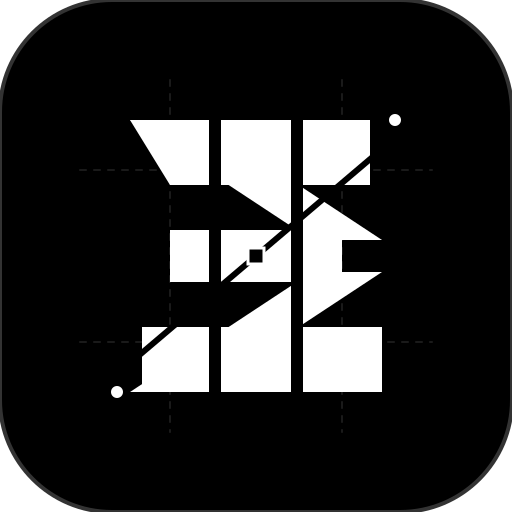

<div align="center">

<p align="center">
  <b>Bahasa Indonesia</b> · <a href="README.en.md">English</a>
</p>



# Sharphy: CLR Intelligence & Runtime Forensic Bridge

### Model Context Protocol (MCP) server native untuk mentransformasi AI coding agent menjadi diagnostisi mendalam, analis forensik memori, dan arsitek biner .NET.
**Eksploitasi kekayaan metadata ECMA-335, analisis crash dump langsung dari runtime, dan navigasi bytecode CIL secara presisi.**

<p align="center">
  <a href="https://www.nuget.org/packages/Sharphy.Cli"></a>
  <a href="#"></a>
  <a href="https://dotnet.microsoft.com/download"></a>
  <a href="LICENSE"></a>
  <a href="https://github.com/baharmaulidiii/sharphy"></a>
</p>

<p align="center">
  <a href="#quick-start"><b>Mulai Cepat</b></a> ·
  <a href="#ekosistem-paket--manfaat"><b>Paket & Manfaat</b></a> ·
  <a href="#kemampuan-inti"><b>Kemampuan Inti</b></a> ·
  <a href="#katalog-mcp-tools"><b>Katalog MCP Tools</b></a> ·
  <a href="#faq"><b>FAQ</b></a> ·
  <a href="CONTRIBUTING.md"><b>Kontribusi</b></a>
</p>

```bash
dotnet tool install -g Sharphy.Cli
```

</div>

> [!CAUTION]
> **Pernyataan Penyangkalan & Aspek Legal (Disclaimer)**
> Sharphy dirancang khusus untuk riset keamanan, diagnostik runtime, audit kerentanan, investigasi insiden, dan analisis biner yang sah secara hukum. Pengguna bertanggung jawab penuh mematuhi hukum yang berlaku, EULA, serta hak cipta perangkat lunak target. Pengembang dan kontributor tidak bertanggung jawab atas penyalahgunaan. Lihat [DISCLAIMER.md](DISCLAIMER.md).

> [!IMPORTANT]
> Dapatkan dan jalankan Sharphy hanya dari sumber terpercaya: NuGet (`Sharphy.Cli`), atau build langsung dari repositori resmi di [github.com/baharmaulidiii/sharphy](https://github.com/baharmaulidiii/sharphy).

---

## Ekosistem Paket & Manfaat

Sharphy dibagi menjadi 3 komponen paket modular dengan peran dan manfaat spesifik:

| Paket NuGet | Tipe | Manfaat & Peran Utama |
| :--- | :--- | :--- |
| **`Sharphy.Cli`** | `.NET Global Tool` | **Untuk User & Terminal Agent:** Alat baris perintah global (`sharphy`) yang dapat diinstal langsung di mesin apa pun (`dotnet tool install -g Sharphy.Cli`). Berfungsi sebagai launcher siap pakai untuk menjalankan server MCP (`sharphy mcp start`) atau melakukan inspeksi biner/dump langsung via CLI. |
| **`Sharphy.Core`** | `Class Library` | **Untuk Developer & Tool Builders .NET:** Engine komprehensif yang merangkum pustaka diagnostik tingkat rendah (ClrMD), dekompilasi (ILSpy engine), manipulasi CIL bytecode (Mono.Cecil/dnlib), dan Roslyn. Dapat di-reference ke dalam aplikasi .NET apa pun tanpa dependensi MCP. |
| **`Sharphy.Server`** | `Class Library / Host` | **Untuk Integrasi Runtime & Agent Frameworks:** Implementasi protokol standar Model Context Protocol (MCP) berbasis JSON-RPC 2.0 (Stdio & SSE transport). Memetakan kemampuan `Sharphy.Core` menjadi tools dan resources yang dapat dipanggil langsung oleh LLM coding agents (Cursor, Claude Code, Windsurf, Copilot, dll.). |

---

Sharphy menghubungkan AI coding agent (Claude Code, Cursor, Windsurf, Copilot, Gemini) secara native ke ekosistem internal .NET:

* **Forensik Memory Dump & CLR Telemetry:** Membaca crash dump (`.dmp`) lintas OS (Windows/Linux) via ClrMD, mendeteksi deadlock antar-thread, menganalisis fragmentasi LOH (Large Object Heap), dan melacak memory leak.
* **Rekonstruksi Kode & Inspeksi Metadata:** Membaca hierarki ECMA-335, atribut compiler, P/Invoke, dan merekonstruksi method CIL menjadi representasi C# modern yang bersih via ILSpy engine.
* **Unpacking & Integritas Biner:** Mendeteksi pola CFG flattening, proxy delegates, dan mengeksekusi decryptor secara terisolasi menggunakan `AssemblyLoadContext`.
* **Mutasi CIL & Dynamic Patching:** Modifikasi instruksi CIL (opcode replacement, bypass validasi internal) dan menghasilkan wrapper performa tinggi menggunakan `UnsafeAccessor` atau Roslyn.

---

## Quick Start

### 1. Pasang Global CLI Tool

```bash
dotnet tool install -g Sharphy.Cli
```

### 2. Hubungkan ke AI Agent Anda (Claude Code / Cursor / Windsurf)

Tambahkan konfigurasi Sharphy ke client MCP Anda (`mcpServers`):

```json
{
  "mcpServers": {
    "sharphy": {
      "command": "sharphy",
      "args": ["mcp", "start"]
    }
  }
}
```

Atau jalankan langsung dari source code lokal melalui `dotnet run`:

```json
{
  "mcpServers": {
    "sharphy": {
      "command": "dotnet",
      "args": ["run", "--project", "D:/Programming/GitHub/sharphy/src/Sharphy.Cli/Sharphy.Cli.csproj", "--", "mcp", "start"]
    }
  }
}
```

---

## Katalog MCP Tools

| Nama Tool | Kategori | Deskripsi |
| :--- | :--- | :--- |
| `sharphy_analyze_dump` | Diagnostik | Analisis otomatis Root Cause Analysis (RCA) pada file crash dump (`.dmp`). |
| `sharphy_inspect_heap` | Diagnostik | Audit managed heap: memory leak, retensi objek, duplikasi string, dan LOH fragmentation. |
| `sharphy_deadlock_detector`| Diagnostik | Pelacakan deadlock dan contention monitor lock antar thread secara mendalam. |
| `sharphy_decompile_method` | Rekonstruksi | Dekompilasi method CIL spesifik menjadi kode C# bersih beserta atribut kompilernya. |
| `sharphy_diff_assemblies` | Metadata | Komparasi dua versi assembly `.dll`/`.exe` untuk melacak breaking API changes dan alterasi internal. |
| `sharphy_inspect_metadata` | Metadata | Inspeksi struktur type ECMA-335, signature native P/Invoke, generic arguments, dan resource tersemat. |
| `sharphy_clean_obfuscation`| Integritas | Analisis dan perapian teknik obfuscation dasar (CFG flattening, proxy calls). |
| `sharphy_extract_tokens` | Integritas | Penelusuran decryption token dalam sandbox `AssemblyLoadContext` terisolasi. |
| `sharphy_patch_il` | Mutasi | Patching instruksi CIL langsung dan re-emit biner tanpa memerlukan source code awal. |
| `sharphy_generate_wrapper` | Mutasi | Otomatisasi pembuatan strongly-typed C# wrapper melalui `UnsafeAccessor` performa tinggi. |

---

## Arsitektur & Multi-Targeting

Sharphy dirancang untuk multi-targeting lintas framework modern .NET:
* **.NET 8.0 (LTS)**
* **.NET 9.0 (STS)**
* **.NET 10.0 (Preview / Latest)**

```text
sharphy/
├── src/
│   ├── Sharphy.Core/           # CLR Diagnostics, ILSpy, ClrMD, Roslyn, Cecil
│   ├── Sharphy.Server/         # MCP Protocol Layer (Stdio & SSE Transport)
│   └── Sharphy.Cli/            # Global CLI Launcher
├── samples/
│   └── CrackmeDemo/            # Testbed binary untuk verifikasi agent
├── tests/
│   └── Sharphy.Tests/          # Unit & integration testing
├── .github/workflows/          # CI matrix build & test pipeline
└── README.md
```

---

## FAQ

<details>
<summary><b>Apakah Sharphy memerlukan source code asli untuk menganalisis?</b></summary>
Tidak. Sharphy bekerja langsung pada biner terkompilasi (.dll, .exe), crash dump memori (.dmp), atau proses runtime aktif.
</details>

<details>
<summary><b>Apakah Sharphy berjalan di Windows dan Linux?</b></summary>
Ya. Seluruh engine dibangun di atas platform modern .NET 8/9/10 dan mendukung dump Windows maupun Linux CoreCLR ELF dumps.
</details>

---

## Kontribusi & Keamanan

- Baca panduan kontribusi di [CONTRIBUTING.md](CONTRIBUTING.md).
- Laporan keamanan dan kerentanan dapat diajukan sesuai [SECURITY.md](SECURITY.md).
- Syarat dan ketentuan legal tersedia di [DISCLAIMER.md](DISCLAIMER.md).

## Lisensi

Sharphy dilisensikan di bawah [Lisensi MIT](LICENSE).
