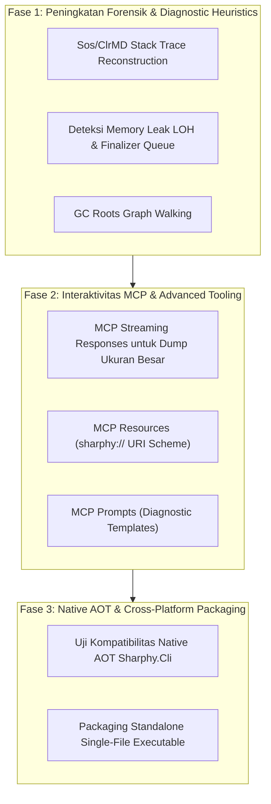

# Peta Jalan & Rencana Pengembangan Lanjutan (Roadmap & Future Plan)

Dokumen ini memuat status kesehatan arsitektur per versi stabil **v1.0.3** serta peta jalan strategis pengembangan **Sharphy: CLR Intelligence & Runtime Forensic Bridge** untuk rilis mendatang.

---

## 1. Status Kesehatan Arsitektur (Baseline v1.0.3)

Per versi 1.0.3, Sharphy telah mencapai standar implementasi murni (*Zero Code Halusinasi / Stub Elimination*):

| Komponen & Engine | Pustaka Eksternal / Runtime | Kapabilitas Faktual |
|---|---|---|
| **`DecompilerEngine`** | `ICSharpCode.Decompiler` (ILSpy) | Dekompilasi instruksi CIL bytecode menjadi representasi kode C# modern yang valid. |
| **`MetadataEngine`** | `Mono.Cecil` | Ekstraksi hierarki tipe ECMA-335, method signatures, visibilitas, dan ketergantungan assembly. |
| **`BinaryDiffEngine`** | `Mono.Cecil` | Perbandingan biner antara dua assembly untuk mendeteksi penambahan/penghapusan tipe, breaking public API changes, serta selisih instruksi & ukuran byte CIL. |
| **`ObfuscationAnalyzerEngine`** | `Mono.Cecil` | Deteksi pola Control Flow Graph (CFG) switch flattening, NOP bloat / junk code, dan pelacakan proxy delegate refleksi dinamis. |
| **`DumpForensicsEngine`** | `Microsoft.Diagnostics.Runtime` (ClrMD) | Analisis crash dump Windows/Linux (.dmp / ELF), pelacakan exception HRESULT, dan inspeksi objek managed heap. |
| **`IlPatcherEngine`** | `Mono.Cecil` & `Cil` | Penggantian dan mutasi op code CIL bytecode pada tingkat instruksi biner. |
| **`SandboxEngine`** | `AssemblyLoadContext` kolektibel | Pemuatan dan inspeksi assembly dinamis terisolasi (`isCollectible: true`) tanpa mengunci file atau membocorkan memori host. |
| **`WrapperGeneratorEngine`** | `System.Runtime.CompilerServices` | Sintesis wrapper C# otomatis untuk pemanggilan anggota *private* tanpa overhead refleksi menggunakan atribut `[UnsafeAccessor]` (.NET 8+). |
| **Protokol MCP Host** | JSON-RPC 2.0 via Stdio | Stream `stdout` murni berisi payload JSON-RPC, dengan seluruh log diagnostik terisolasi di `stderr`. |

---

## 2. Peta Jalan Strategis (Future Roadmap)

---

### Fase 1: Peningkatan Forensik & Diagnostik Lanjutan (ClrMD Deep Analysis)
- **GC Roots Graph Walking:** Mengidentifikasi rantai referensi GC root yang menahan objek besar di memori, mengungkap akar penyebab *memory leak*.
- **Finalizer Queue Health:** Menganalisis antrean objek finalizer untuk mendeteksi pemblokiran (*stalled finalizer thread*).
- **Deep Thread Callstack Reconstruction:** Menampilkan parameter register CPU dan frame managed/native secara akurat pada laporan analisis dump.

---

### Fase 2: Ekosistem MCP 2024-11-05 Lanjutan (Resources & Prompts)
- **MCP Resources (`sharphy://` URI Scheme):**
  - Mengekspos rakitan biner dan dump sebagai resource yang dapat dijelajahi oleh LLM agent (misal: `sharphy://assemblies/{name}/types/{type}`).
- **MCP Prompts:**
  - Menyediakan templat percakapan siap pakai untuk AI coding agent:
    - `sharphy_diagnose_crash_dump`: Workflow otomatis menganalisis akar crash.
    - `sharphy_reverse_engineer_flow`: Workflow merekonstruksi logika bisnis dari biner terobfuskasi.
- **Streaming Result Handling:**
  - Optimasi respons untuk output dump dan dekompilasi berukuran puluhan megabyte agar efisien dalam konsumsi token LLM.

---

### Fase 3: Native AOT & Distribusi Tanpa Runtime
- **Native AOT Compilation:**
  - Mengonfigurasi `PublishAot=true` pada `Sharphy.Cli` untuk menghasilkan biner mandiri (*zero-dependency executable*).
  - Mengurangi waktu startup MCP server menjadi hitungan milidetik saat dipanggil oleh editor AI (Cursor, Claude Code, Antigravity, Windsurf).
- **Distribusi Multi-Arsitektur:**
  - Menyediakan executable biner langsung untuk Windows (x64/arm64), Linux (x64/arm64 musl/glibc), dan macOS (Apple Silicon).

---

## 3. Pedoman Pemeliharaan Rilis

Sesuai governance di [AGENTS.md](AGENTS.md):
- **Versioning:** Mengikuti Semantic Versioning (SemVer).
- **Rilis Otomatis:** Dipicu terpusat melalui GitHub Actions (`Release Orchestrator` via `workflow_dispatch`). Tidak memerlukan pembuatan git tag manual di CLI lokal.
- **Multi-Targeting:** Setiap kontribusi kode baru wajib mempertahankan kompatibilitas lintas `.NET 8.0`, `.NET 9.0`, dan `.NET 10.0`.
