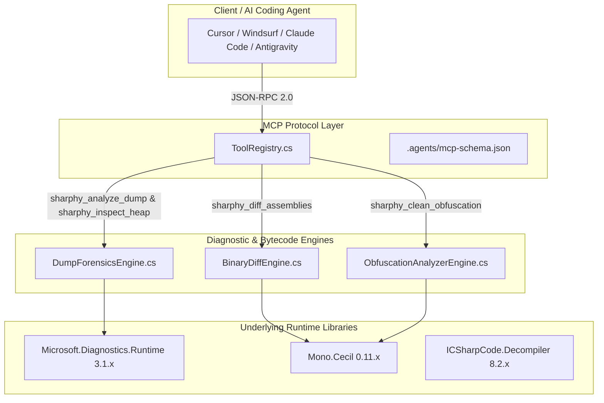
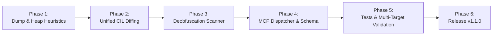

# Sharphy Engineering Milestone: v1.1.0 Roadmap

This document defines the actionable engineering blueprint for **Milestone v1.1.0** of the **Sharphy: CLR Intelligence & Runtime Forensic Bridge** ecosystem, translating the high-level objectives from [ROADMAP.md](../../ROADMAP.md#L21-L32) into concrete architectural deliverables.

---

## 1. Executive Summary & Objective

Sharphy `v1.0.5` established a robust, general-availability foundation with 10 diagnostic MCP tools, collectible `AssemblyLoadContext` sandboxing, and cross-framework support across `.NET 8.0`, `.NET 9.0`, and `.NET 10.0`.

**Milestone v1.1.0** transitions Sharphy from passive metadata inspection to **Active CLR Diagnostic & Heuristic Intelligence**:
1. **Automated ThreadPool Starvation Triage:** Detecting sync-over-async blockages and lock deadlocks directly from memory crash dumps.
2. **GC Heap Fragmentation & Pinning Telemetry:** Quantifying Free object distribution and tracking `HandleKind.Pinned` objects that degrade Garbage Collection compaction.
3. **Unified Line-by-Line CIL Diffing:** Emitting standard unified diff output (`+`/`-`) at the bytecode instruction level for AI coding agents.
4. **Pattern-Matching String Decryptors:** Unmasking runtime proxy methods and XOR/bitwise decoding loops in obfuscated assemblies.

---

## 2. High-Level Architecture & Flow



---

## 3. Detailed Component Deliverables

### 3.1 DumpForensicsEngine (`Sharphy.Core`)

#### Feature: ThreadPool Starvation & Sync-over-Async Heuristics
- **Target Tool:** `sharphy_analyze_dump`
- **Mechanism:**
  - Query `ClrRuntime.ThreadPool` metrics (total threads, running requests, completion port status).
  - Walk active managed threads via `thread.EnumerateStackTrace()`.
  - Match blocking frames against known thread starvation signatures:
    - `System.Threading.Tasks.Task.Wait`
    - `System.Threading.Tasks.Task.GetResult`
    - `System.Threading.Monitor.Enter` / `System.Threading.Monitor.Wait`
    - `System.Threading.ManualResetEventSlim.Wait`
  - Output explicit warnings: `[⚠️ THREADPOOL STARVATION DETECTED]` with culprit thread IDs and callstacks.

#### Feature: GC Heap Fragmentation & LOH Pinning Telemetry
- **Target Tool:** `sharphy_inspect_heap`
- **Mechanism:**
  - Enumerate each `ClrSegment` across Generation 0, Generation 1, Generation 2, and the Large Object Heap (LOH).
  - Calculate total `Free` memory versus allocated objects to produce a **Heap Fragmentation Percentage (%)**.
  - Scan `ClrRuntime.EnumerateHandles()` for `HandleKind.Pinned`:
    - Display pinned object memory addresses, types, and segment locations.
    - Flag Gen 0 / Gen 1 pinned instances preventing generational compaction.

---

### 3.2 BinaryDiffEngine (`Sharphy.Core`)

#### Feature: Unified Line-by-Line CIL Diffing
- **Target Tool:** `sharphy_diff_assemblies`
- **Mechanism:**
  - Disassemble modified method IL streams instruction-by-instruction.
  - Implement a standard unified diff algorithm comparing baseline vs. updated instructions.
  - Produce clean, agent-readable output:
    ```text
    --- Baseline: SecurityService::ValidateToken
    +++ Updated : SecurityService::ValidateToken
    @@ IL_000c,4 @@
    - IL_000c: ldc.i4.0
    + IL_000c: ldc.i4.1
    - IL_000d: ret
    + IL_000d: call bool SecurityService::AuditLog()
    + IL_0012: ret
    ```
- **MCP Schema Update:** Add optional `includeCilDiff` boolean parameter (default: `true`) to `.agents/mcp-schema.json`.

---

### 3.3 ObfuscationAnalyzerEngine (`Sharphy.Core`)

#### Feature: Pattern-Matching String Decryptor
- **Target Tool:** `sharphy_clean_obfuscation`
- **Mechanism:**
  - Scan static method bodies for decryption loops (combinations of `ldelem.u1`, `xor`, `bne.un`, and `conv.u1`).
  - Report detected resolver method tokens and classify decryption complexity.

---

### 3.4 Protocol & Test Suite (`Sharphy.Tests`)

- **New Test Fixtures:**
  - `BinaryDiffEngine_UnifiedCilDiff_OutputsAccurateInstructions`
  - `DumpForensicsEngine_DetectsThreadPoolStarvation_OnBlockedDump`
  - `ObfuscationAnalyzer_FlagsXorStringDecryptor`
- **Target Coverage:** Expand automated tests from 11 to **at least 14 tests**, maintaining 100% pass rates on `.NET 8.0` and `.NET 10.0`.

---

## 4. Work Breakdown & Implementation Phases



1. **Phase 1 (Diagnostics):** Implement `AnalyzeThreadPoolStarvation` and `AnalyzeHeapFragmentation` in `DumpForensicsEngine.cs`.
2. **Phase 2 (Bytecode):** Implement `GenerateCilDiff` in `BinaryDiffEngine.cs`.
3. **Phase 3 (Deobfuscation):** Implement pattern recognition in `ObfuscationAnalyzerEngine.cs`.
4. **Phase 4 (Protocol):** Expose features in `ToolRegistry.cs` and update `.agents/mcp-schema.json`.
5. **Phase 5 (Verification):** Add unit tests in `Sharphy.Tests`, verify multi-target build (`net8.0`, `net9.0`, `net10.0`).
6. **Phase 6 (Deployment):** Update `CHANGELOG.md`, tag release, and dispatch package deployment.

---

## 5. Verification & Acceptance Criteria

All contributions for `v1.1.0` must satisfy:
1. **Multi-Target Compilation:**
   ```powershell
   dotnet build Sharphy.sln -c Release
   ```
2. **Automated Test Suite Execution:**
   ```powershell
   dotnet test Sharphy.sln -c Release --no-build
   ```
3. **NuGet Packaging Verification:**
   ```powershell
   dotnet pack Sharphy.sln -c Release
   ```
4. **Zero Unhandled Regressions:** Existing 10 MCP tools must preserve backward-compatible input/output signatures.
